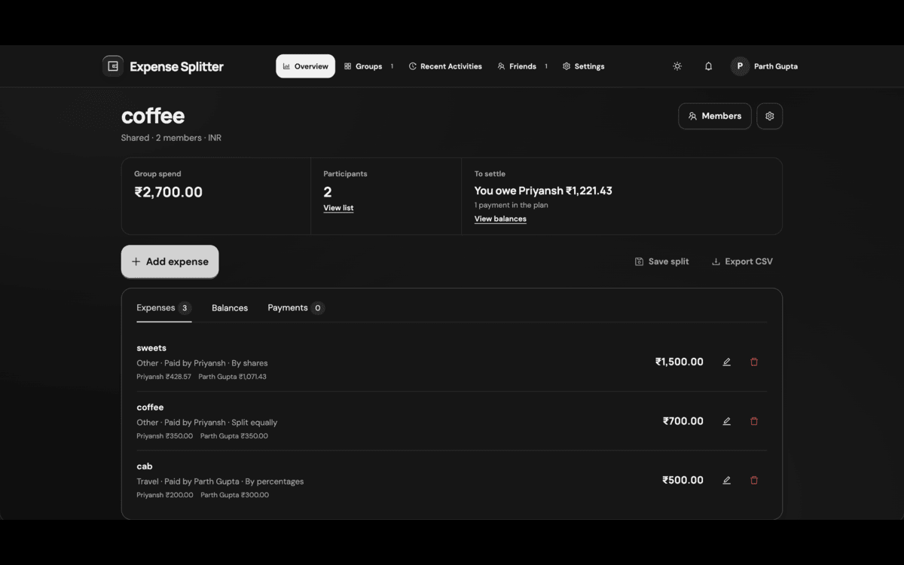
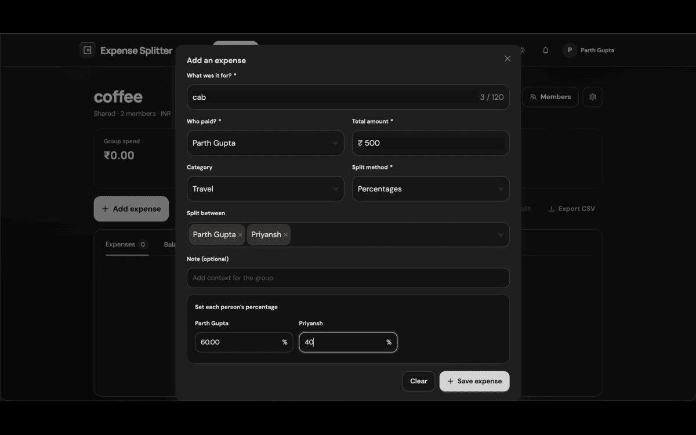
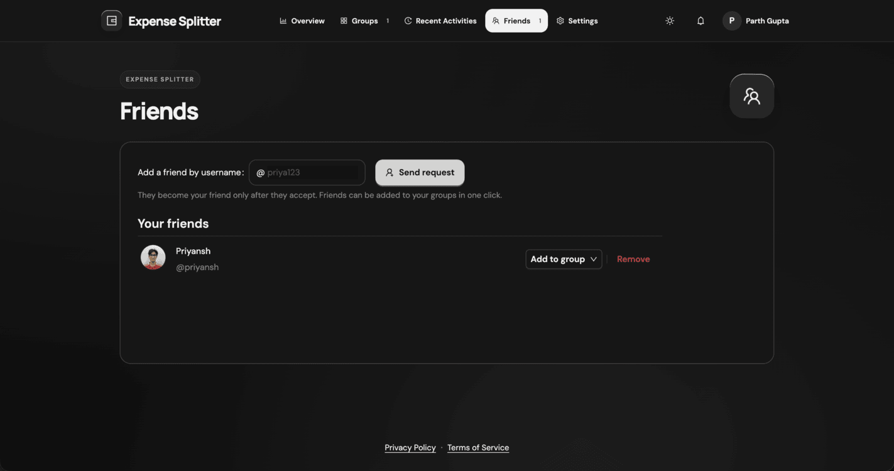
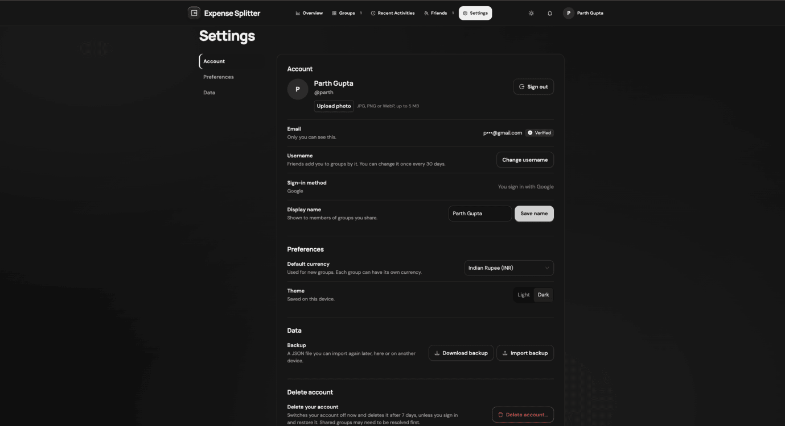

# Expense Splitter

Splitting bills with friends, flatmates or a trip group gets awkward fast. Expense Splitter does the maths, tracks who paid what, and tells everyone the fewest payments needed to square up.


## End-term project submission

| | |
|---|---|
| **Student** | Parth Gupta |
| **Live app** | https://expense-splitter-two-liart.vercel.app/ |
| **Repository** | https://github.com/parthgupta-5/expense-splitter |
| **Demo video** | https://drive.google.com/drive/folders/18WCMGBshCLx_oNikPugSDe6uieNrnyx3?usp=sharing |
| **Tech stack** | React 19, Vite, Ant Design, Supabase (Postgres, Auth, Row Level Security, Realtime, Storage, Edge Functions), Vercel |

## Screenshots

<table>
  <tr>
    <td></td>
    <td></td>
  </tr>
  <tr>
    <td></td>
    <td></td>
  </tr>
</table>

## Try it in 5 minutes

No account needed for the first part.

1. Open the [live app](https://expense-splitter-two-liart.vercel.app/) and create a group, for example "Goa trip".
2. Add three people, then add expenses using different split types: equal, exact amounts, shares and percentages.
3. Open **Balances**. Each person shows "Owes", "Is owed" or "Settled", along with the shortest repayment plan. Record a payment and watch the plan shrink.
4. Sign up (email with a 6-digit code, or Google) and pick a @username. The app offers to move your guest group into the account.
5. To see sharing, use a second browser or a private window with a second account:
   - **Friends** → send a friend request to the other @username, then accept it from the bell.
   - **Add to group** on the Friends page sends a group invitation. Accept it from the bell and the group opens.
   - Add an expense in one browser and it appears in the other without a reload.
6. **Recent Activities** shows who did what across your groups. **Settings → Delete account** switches the account off and gives you 7 days to restore it by signing in again.

## What it does

### Record and split expenses

- Several groups, each with its own currency.
- Pick who paid and who took part, then split **equally, by exact amounts, by shares or by percentages**.
- Every amount is stored as an integer number of cents. Splits use the largest-remainder method, so the parts always add up to the total (₹100 split three ways is 33.34 + 33.33 + 33.33).
- Expenses can be edited and deleted.

### Balances and settle-up

- A live net balance per person, in plain words.
- A suggested repayment plan of at most N−1 payments for N people, which can be copied as text for a group chat.
- Recording a payment updates the plan. Paying more than is owed asks for confirmation.

### Sharing a group

- Add people by exact @username. That adds them to the expenses and sends a group invitation in one step.
- Add guests by name, with no account or email needed.
- Each person shows a clear status: you, member, invitation pending, declined, expired or guest.
- Only the owner renames the group, changes its currency, manages invitations or deletes it. Members can leave.
- Changes from other members show up live through Supabase Realtime.

### Friends

- Send a request to an exact @username. It becomes a friendship only when the other person accepts.
- After a decline, the sender can ask again after 7 days. Sent requests can be cancelled and friends can be removed.
- **Add to group** puts a friend into any group you own in one click.

### Accounts

- Email sign-up confirmed by a 6-digit code, Google sign-in, password reset by emailed code, and change password.
- Unique @username and a profile photo, which is re-encoded in the browser to strip location data.
- Groups made as a guest can be moved into the account when signing in.
- **Account deletion has a 7-day safety window.** The account is switched off immediately: signed out everywhere, hidden from search, and pending invitations withdrawn. Signing in within 7 days offers **Restore my account**. After that, a scheduled job deletes it for good.

### Everything else

- **Bell:** holds only what needs an answer (group invitations and friend requests).
- **Recent Activities:** a server-written log of who did what, plus saved snapshots of settle-ups.
- **Backup and export:** JSON backup and restore with validation, and a per-group CSV export that is safe to open in spreadsheets.
- **Real URLs:** every page and group has its own address, so refresh, back and bookmarks work.
- **Guest mode:** the whole app works without an account, with data kept in the browser.
- Light and dark theme, mobile-friendly layout, keyboard and screen-reader support, and Privacy Policy and Terms pages.

## Tech stack

| Layer | Choice |
|---|---|
| UI | React 19, React Router 7, Ant Design 6, Vite |
| Backend | Supabase: Postgres, Auth, Row Level Security, Realtime, Storage |
| Server code | Supabase Edge Functions (Deno) for account switch-off and the daily final deletion |
| Email | Brevo as the SMTP provider |
| Hosting | Vercel |
| Tests | Vitest, Testing Library, PGlite (Postgres in WebAssembly), Playwright |
| Quality | ESLint, GitHub Actions CI, a secret scanner |

There is no custom backend server. The browser talks to Supabase directly with the public key and the signed-in user's token, and **Postgres decides what each user may do**. That removes a layer to build and secure, and it means a rule cannot be skipped by calling the API without the app.

## Engineering highlights

- **Money is integer cents everywhere**: in the app, in backups and in `bigint` columns.
- **Rules live in the database as well as the UI.** Triggers reject shares that don't add up, payers outside the group and fractional cents, even for a hand-made API call.
- **SQL and JavaScript balance maths are tested against each other** on randomly generated groups.
- **One row per change.** An early version stored each group as one JSON document, so two people editing at once overwrote each other. Every expense, payment and person is now its own row.
- **Multi-step actions are single transactions**, such as adding someone by username (person and invitation together, or neither).
- **Optimistic updates with honest rollback.** The screen updates at once, and if the database refuses the write, the user sees why and the group is re-read from the server.
- **Security by default.** Row Level Security on every table, no secrets in the repo or the browser, rate limits, and a Content-Security-Policy.

Full detail is in the [docs](#docs).

## Run it locally

Requires Node 20.19+ or 22.12+.

```bash
git clone https://github.com/parthgupta-5/expense-splitter.git
cd expense-splitter
npm install
cp .env.example .env    # optional: without it the app runs in guest mode only
npm run dev             # http://localhost:5173
```

To use accounts, add your Supabase values to `.env`:

```env
VITE_SUPABASE_URL=https://<project-ref>.supabase.co
VITE_SUPABASE_ANON_KEY=<your-anon-key>
```

Both values are public by design. Row Level Security enforces access. Never put the `service_role` key in a `VITE_*` variable.

Other commands:

```bash
npm test                # unit, app and database tests
npm run test:unit       # only the tests in src/
npm run test:db         # database tests (no Supabase project needed)
npm run test:e2e        # browser tests (first time: npx playwright install chromium)
npm run lint
npm run build
npm run preflight       # lint + tests + build + secret scan, run before pushing
```

## Testing

| Suite | Covers |
|---|---|
| Unit and app | Split, balance and settlement maths, money parsing, reducers, and real screens with a mocked data layer |
| Database (PGlite) | The real SQL migrations in Postgres, acting as different users: access rules, validation triggers, the 7-day deletion window, rate limits, rollbacks |
| Browser (Playwright) | The production build in Chromium on desktop and phone sizes |

CI runs the secret scan, lint, all tests and the build on every pull request and push to `main`. Real email delivery, Realtime itself and the deployed Edge Functions are checked by hand. More in [docs/TESTING.md](docs/TESTING.md).

## Deployment

The live app runs on **Vercel** (frontend) and **Supabase** (database, sign-in, functions).

### 1. Supabase

1. Create a project at [supabase.com](https://supabase.com).
2. In the **SQL Editor**, run every file in `supabase/migrations/` in filename order. Each one is safe to run again.
3. Under **Authentication → Providers → Email**, turn on **Confirm email**, set the OTP length to 6, and require passwords of 12+ characters. Put `{{ .Token }}` in the **Confirm signup** and **Reset password** templates (editing templates needs custom SMTP, such as Brevo).
4. Optional: add Google as a provider with a Google Cloud OAuth *Web application* client.
5. Under **Authentication → URL Configuration**, set the Site URL to your Vercel URL and add `/auth/callback` for it and for `http://localhost:5173` to the redirect list.

### 2. Edge Functions and the daily job

1. Deploy `delete-account` and `purge-deleted-accounts` (the second with JWT verification off) using the Supabase CLI or the dashboard.
2. Add a `CRON_SECRET` secret (a long random string).
3. Enable the **pg_cron** and **pg_net** extensions, then schedule `purge-deleted-accounts` once a day with an `x-cron-secret` header.

### 3. Vercel

1. Import the GitHub repository (framework preset **Vite**).
2. Set `VITE_SUPABASE_URL` and `VITE_SUPABASE_ANON_KEY`.
3. Deploy. `vercel.json` rewrites every path to `index.html` and sets the security headers.

## Docs

- [Architecture and database](docs/ARCHITECTURE.md)
- [Security and access rules](docs/SECURITY.md)
- [Engineering decisions](docs/DECISIONS.md)
- [Testing](docs/TESTING.md)
- [Future improvements and known limitations](docs/IMPROVEMENTS.md)

## Future improvements

Planned next, and known limitations. The full list is in [docs/IMPROVEMENTS.md](docs/IMPROVEMENTS.md).

- **Expense dates:** record when a cost happened, not just when it was entered.
- **Undo for deletes:** a short undo window for removed expenses and groups.
- **Search:** find expenses by name, person or amount.
- **Settle-up summary:** a printable or PDF version, plus spending totals by category and person.
- **Ownership transfer:** hand a group to another member. Today an owner must delete a shared group before deleting their account.
- **Receipt photos:** attach a picture to an expense.
- **Limitations today:** no currency conversion (one currency per group), no offline queue, no email or push notifications, and adding by username needs the other person to have an account.

## AI usage

AI tools (Claude) were used for reviewing the product, debugging, refactoring, writing tests and documentation. Every change was reviewed by the author, who is responsible for the final product and its design decisions.

## Originality

An original project built with open-source libraries (React, React Router, Ant Design, the Supabase client, Vite). No existing application or tutorial project was forked.

## License

MIT. See [LICENSE](LICENSE).

## Author

Parth Gupta
